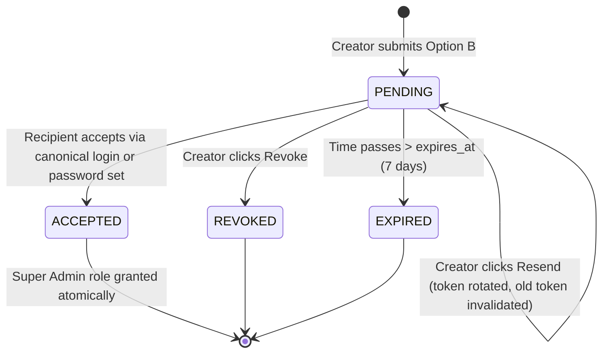

# BEYONDSURE HRMS — PHASE 3E
# ORGANIZATION SUPER ADMIN ASSIGNMENT AND EMAIL INVITATIONS
## Architecture Audit and Implementation Plan (Revised Phase 3E.1)

**Date:** 2026-10-13  
**Role:** Dev1 only  
**Branch:** `dev1`  
**Status:** REVISED ARCHITECTURAL SPECIFICATION (Security Hardened)  
**Security Review Reference:** `docs/PHASE3E1_SECURITY_DESIGN_REVIEW.md`

---

## 1. Existing Components and Files Inspected

During Step 1 of Phase 3E, the authentication, authorization, onboarding, notification, and audit subsystems were audited:

| Subsystem | Inspected Files | Key Findings |
|---|---|---|
| **User & Account Models** | `backend/apps/accounts/models.py`, `backend/apps/accounts/serializers.py` | `User` model defines `UserStatus.INVITED ('invited')`, `ACTIVE ('active')`, `INACTIVE ('inactive')`. `is_active` evaluates `status == 'active'`. `TenantOwnerRegistration` tracks the verified organization creator. |
| **Auth & Activation Flows** | `backend/apps/accounts/views.py`, `backend/apps/accounts/urls.py` | Canonical authentication flow is `LoginView` at `/api/v1/accounts/login/`. `ActivateView` uses Django's `default_token_generator` to activate invited users and set their initial passwords. Token issuance is strictly restricted to canonical authentication flows. |
| **Email & Notification Service** | `backend/apps/notifications/services.py`, `backend/config/settings.py` | `NotificationService` wraps `send_mail` using `settings.DEFAULT_FROM_EMAIL` and `settings.FRONTEND_URL`. Handles exceptions gracefully and logs failures without interrupting transaction rollbacks. |
| **Organization & Onboarding** | `backend/apps/organization/models.py`, `backend/apps/organization/services.py`, `backend/apps/organization/views.py`, `backend/apps/organization/serializers.py` | `OrganizationOnboarding` tracks wizard stages 1–7. Stage 6 (`execute_stage_6`) ensures `Role(slug='super-admin')` exists with all canonical permissions. `OnboardingStage6Serializer` currently accepts `{"confirm": true}`. |
| **Dynamic RBAC & Authorization** | `backend/apps/authorization/models.py`, `backend/apps/authorization/services.py`, `backend/apps/authorization/permissions.py` | `Role` (unique per organization + slug), `RolePermission` (linking 144 canonical permissions), `UserRole` (scope: `organization`, `branch`, `team`). Dynamic super-admin resolution checks `_is_active_org_superadmin(user, org)`. Strict isolation: zero global superuser bypass. |
| **Audit Logging** | `backend/apps/audit/services.py`, `backend/apps/audit/models.py` | `AuditService.log(action, actor, target_type, target_id, metadata, request, organization)` records immutable events with client IP and JSON metadata. |
| **Frontend Setup Wizard** | `frontend/src/pages/setup/stages/Stage6AdminRbac.tsx`, `frontend/src/services/onboardingService.ts`, `frontend/src/routes/AppRouter.tsx` | Stage 6 UI currently provides a single checkbox for self-assignment. Service defines `Stage6Payload = { confirm: boolean }`. Routes use dedicated layout. |
| **Existing Test Suites** | `backend/apps/organization/tests_onboarding_wizard.py`, `backend/apps/accounts/tests.py` | Comprehensive test patterns using `APIClient`, `force_authenticate`, cross-tenant assertions, and transactional rollbacks. |

---

## 2. Reusable Infrastructure vs New Additions

### 2.1 Reusable Infrastructure (No Duplication)
1. **Dynamic RBAC Engine (`apps.authorization`):**
   - Reuses existing `Role(slug='super-admin')` auto-provisioning.
   - Reuses `RolePermission` bulk-attachment of all canonical permissions.
   - Reuses `UserRole(scope=ScopeChoices.ORGANIZATION)` for role assignments.
   - Reuses `AuthorizationService.is_super_admin(user, organization)` and tenant-scoping logic.
2. **User Authentication & Account Management (`apps.accounts`):**
   - **Canonical Login Flow:** All existing users **must** authenticate via the standard `/api/v1/accounts/login/` flow. No parallel login mechanism is created.
   - Reuses `User.objects.create_user(email=..., status=UserStatus.INVITED)` for new accounts.
   - Reuses Django password validation rules (`validate_password`).
3. **Email Delivery (`apps.notifications`):**
   - Reuses `NotificationService` pattern for templated email dispatch using configured `EMAIL_BACKEND` and `FRONTEND_URL`.
4. **Audit Logging (`apps.audit`):**
   - Reuses `AuditService.log` with organization context, actor attribution, and JSON metadata.
5. **Frontend Layout & Form Conventions:**
   - Reuses the existing Phase 3D Setup Wizard design system, banners, responsive cards, and API client error handling.

### 2.2 Concrete Justification for New Component
- **`OrganizationInvitation` Model:** The repository currently has **zero** invitation models. Employee and candidate onboarding use ad-hoc flows with single-use activation tokens that do not capture organizational role binding, expiration timestamps, revocation states, or invitation resend counters. To guarantee organization-scoped dynamic RBAC, token hashing, and auditability without polluting generic user models, a dedicated, tenant-bound `OrganizationInvitation` model is required.

---

## 3. Required Model and Database Changes

### 3.1 New Model: `OrganizationInvitation` (`apps.organization.models`)

```python
class InvitationStatus(models.TextChoices):
    PENDING = 'pending', 'Pending'
    ACCEPTED = 'accepted', 'Accepted'
    EXPIRED = 'expired', 'Expired'
    REVOKED = 'revoked', 'Revoked'

class EmailDeliveryStatus(models.TextChoices):
    PENDING = 'pending', 'Pending'
    SENT = 'sent', 'Sent'
    FAILED = 'failed', 'Failed'

class OrganizationInvitation(models.Model):
    """
    Cryptographically secure, single-use invitation for administrative or scoped
    role assignment within a tenant organization.
    """
    organization = models.ForeignKey(
        'organization.Organization',
        on_delete=models.CASCADE,
        related_name='invitations',
        help_text='Tenant organization to which the invitee is being invited.'
    )
    email = models.EmailField(
        db_index=True,
        help_text='Normalized lowercase email of the intended administrator.'
    )
    first_name = models.CharField(max_length=150, blank=True)
    last_name = models.CharField(max_length=150, blank=True)
    role = models.ForeignKey(
        'authorization.Role',
        on_delete=models.CASCADE,
        related_name='invitations',
        help_text='Organization-scoped role to grant upon acceptance.'
    )
    token_hash = models.CharField(
        max_length=64,
        unique=True,
        db_index=True,
        help_text='SHA-256 hash of the single-use invitation token. Raw token is never stored.'
    )
    status = models.CharField(
        max_length=20,
        choices=InvitationStatus.choices,
        default=InvitationStatus.PENDING,
        db_index=True,
    )
    email_delivery_status = models.CharField(
        max_length=20,
        choices=EmailDeliveryStatus.choices,
        default=EmailDeliveryStatus.PENDING,
        db_index=True,
        help_text='Separate status tracking actual SMTP delivery outcome.'
    )
    email_delivery_error = models.TextField(
        blank=True,
        default='',
        help_text='Diagnostic details if email delivery failed.'
    )
    email_sent_at = models.DateTimeField(null=True, blank=True)
    invited_by = models.ForeignKey(
        settings.AUTH_USER_MODEL,
        on_delete=models.SET_NULL,
        null=True,
        related_name='sent_organization_invitations'
    )
    accepted_by = models.ForeignKey(
        settings.AUTH_USER_MODEL,
        on_delete=models.SET_NULL,
        null=True,
        blank=True,
        related_name='accepted_organization_invitations'
    )
    expires_at = models.DateTimeField(
        help_text='Timestamp after which the invitation token is no longer valid.'
    )
    accepted_at = models.DateTimeField(null=True, blank=True)
    revoked_at = models.DateTimeField(null=True, blank=True)
    resend_count = models.PositiveSmallIntegerField(default=0)
    created_at = models.DateTimeField(auto_now_add=True)
    updated_at = models.DateTimeField(auto_now=True)

    class Meta:
        db_table = 'organization_invitation'
        ordering = ['-created_at']
        indexes = [
            models.Index(fields=['organization', 'email', 'status']),
            models.Index(fields=['token_hash']),
        ]
        constraints = [
            models.UniqueConstraint(
                fields=['organization', 'role'],
                condition=models.Q(status='pending'),
                name='unique_pending_org_role_invitation'
            ),
        ]

    def is_expired(self):
        return timezone.now() >= self.expires_at

    def clean(self):
        super().clean()
        if self.role_id and self.organization_id and self.role.organization_id != self.organization_id:
            raise ValidationError({'role': 'Invited role must belong to the invitation organization.'})
```

### 3.2 Migration Strategy
- Create Django migration in `apps.organization`:
  `0015_organizationinvitation.py`
- Fully backwards-compatible additive model with zero modifications to pre-existing tables.

---

## 4. Formal API Specifications

### 4.1 Stage 6 Submission: `POST /api/v1/organization/wizard/stage-6/`
- **Method & Path:** `POST /api/v1/organization/wizard/stage-6/`
- **Authentication:** `IsAuthenticated`
- **Authorization:** `IsOrganizationAdminOrCreator` for target organization
- **Headers:** `Content-Type: application/json`

#### Option A: Self-Assignment
- **Request Body:**
  ```json
  {
    "assignment_type": "self",
    "confirm": true
  }
  ```
  *(Note: Legacy payload `{"confirm": true}` is supported and automatically interpreted as Option A).*
- **Behavior:**
  - Validates caller is organization creator or authorized tenant administrator.
  - Provisions `Role(slug='super-admin')` and links canonical permissions if missing.
  - Creates or restores active `UserRole(user=request.user, role=super_admin_role, scope=ScopeChoices.ORGANIZATION)`.
  - Marks Stage 6 complete.
  - Stores in onboarding metadata:
    ```json
    {
      "stage_6": {
        "assignment_type": "self",
        "role_id": 1,
        "admin_user_id": 10,
        "admin_email": "creator@example.com",
        "status": "active"
      }
    }
    ```
  - Logs `AuditService.log('onboarding_stage_6_self_assigned', ...)`
- **Response (200 OK):**
  ```json
  {
    "current_stage": 7,
    "completed_stages": [1, 2, 3, 4, 5, 6],
    "status": "in_progress",
    "stage_6": {
      "assignment_type": "self",
      "admin_email": "creator@example.com",
      "status": "active"
    }
  }
  ```

#### Option B: Email Invitation
- **Request Body:**
  ```json
  {
    "assignment_type": "invite",
    "first_name": "Sarah",
    "last_name": "Connor",
    "email": "sarah.connor@example.com"
  }
  ```
- **Validation Rules:**
  - `email`: Required, valid email format, normalized to lowercase.
  - `first_name`: Required non-empty string (max 150 chars).
  - `last_name`: Optional string (max 150 chars).
  - If `email == request.user.email`: returns validation error: `{"email": ["To assign yourself as Super Admin, choose Option A ('Assign myself')."]}`
- **Transactional & Dispatch Behavior:**
  - Within `transaction.atomic()`:
    - Revokes any prior pending invitation for this organization & role to satisfy the unique constraint.
    - Generates raw single-use token: `raw_token = secrets.token_urlsafe(32)`.
    - Computes `token_hash = hashlib.sha256(raw_token.encode('utf-8')).hexdigest()`.
    - Computes `expires_at = timezone.now() + timedelta(days=getattr(settings, 'ORGANIZATION_INVITATION_EXPIRY_DAYS', 7))`.
    - Creates `OrganizationInvitation` with `status=PENDING`, `email_delivery_status=PENDING`.
    - Marks Stage 6 complete with metadata:
      ```json
      {
        "stage_6": {
          "assignment_type": "invite",
          "invitation_id": 14,
          "invitee_email": "sarah.connor@example.com",
          "invitee_name": "Sarah Connor",
          "invitation_status": "pending",
          "email_delivery_status": "pending",
          "expires_at": "2026-10-20T10:30:00Z"
        }
      }
      ```
    - Registers `transaction.on_commit(lambda: dispatch_invitation_email(...))`
  - Post-commit dispatch:
    - Calls `NotificationService.send_organization_admin_invitation_email(...)`.
    - If email delivery succeeds: updates `email_delivery_status = SENT`, `email_sent_at = now`.
    - If email delivery fails: updates `email_delivery_status = FAILED`, `email_delivery_error = str(e)`. The invitation record remains valid and can be resent.
- **Response (200 OK):**
  ```json
  {
    "current_stage": 7,
    "completed_stages": [1, 2, 3, 4, 5, 6],
    "status": "in_progress",
    "stage_6": {
      "assignment_type": "invite",
      "invitation_id": 14,
      "invitee_email": "sarah.connor@example.com",
      "invitee_name": "Sarah Connor",
      "invitation_status": "pending",
      "email_delivery_status": "sent",
      "expires_at": "2026-10-20T10:30:00Z"
    }
  }
  ```

---

### 4.2 Resend Invitation: `POST /api/v1/organization/wizard/stage-6/resend/`
- **Method & Path:** `POST /api/v1/organization/wizard/stage-6/resend/`
- **Authentication:** `IsAuthenticated`
- **Authorization:** `IsOrganizationAdminOrCreator`
- **Rate Limit:** 5/minute per user (`UserRateThrottle`)
- **Behavior:**
  - Finds active pending `OrganizationInvitation` for the organization.
  - Generates new `raw_token`, updates `token_hash = sha256(raw_token)`.
  - Resets `expires_at = now + 7 days`.
  - Increments `resend_count`.
  - Resets `email_delivery_status = PENDING`.
  - Dispatches fresh email via `transaction.on_commit()`.
  - Logs `AuditService.log('organization_invitation_resent', ...)`.
- **Response (200 OK):**
  ```json
  {
    "detail": "Invitation resent successfully.",
    "invitation_id": 14,
    "email": "sarah.connor@example.com",
    "status": "pending",
    "email_delivery_status": "sent",
    "resend_count": 1,
    "expires_at": "2026-10-20T11:00:00Z"
  }
  ```

---

### 4.3 Revoke Invitation: `POST /api/v1/organization/wizard/stage-6/revoke/`
- **Method & Path:** `POST /api/v1/organization/wizard/stage-6/revoke/`
- **Authentication:** `IsAuthenticated`
- **Authorization:** `IsOrganizationAdminOrCreator`
- **Rate Limit:** 5/minute per user (`UserRateThrottle`)
- **Behavior:**
  - Marks invitation status as `REVOKED`, sets `revoked_at = timezone.now()`.
  - Updates onboarding metadata `invitation_status: 'revoked'`.
  - Logs `AuditService.log('organization_invitation_revoked', ...)`.
- **Response (200 OK):**
  ```json
  {
    "detail": "Invitation revoked successfully.",
    "invitation_id": 14,
    "status": "revoked"
  }
  ```

---

### 4.4 Public Verification: `GET /api/v1/organization/invitations/verify/`
- **Method & Path:** `GET /api/v1/organization/invitations/verify/?token=<raw_token>`
- **Authentication:** `AllowAny`
- **Rate Limit:** 15/minute per IP (`AnonRateThrottle`)
- **Behavior:**
  - Computes `token_hash = sha256(raw_token)`.
  - Queries `OrganizationInvitation.objects.filter(token_hash=token_hash).first()`.
  - If not found or status != `PENDING`: returns HTTP 400 Bad Request (`{"valid": false, "code": "INVALID_TOKEN", "detail": "Invalid or expired invitation token."}`).
  - If `is_expired()`: updates status to `EXPIRED`, returns HTTP 400 Bad Request (`{"valid": false, "code": "TOKEN_EXPIRED", "detail": "This invitation has expired."}`).
  - **Zero Information Disclosure:** Does **NOT** return `has_existing_account`.
- **Response (200 OK):**
  ```json
  {
    "valid": true,
    "organization_name": "Apex Global Corp",
    "organization_code": "APEX",
    "email": "sarah.connor@example.com",
    "first_name": "Sarah",
    "last_name": "Connor",
    "expires_at": "2026-10-20T11:00:00Z"
  }
  ```

---

### 4.5 Accept Invitation: `POST /api/v1/organization/invitations/accept/`
- **Method & Path:** `POST /api/v1/organization/invitations/accept/`
- **Authentication:** `AllowAny` (Rate-throttled: 5/minute per IP)
- **Concurrency Protection:** Uses `select_for_update()` inside `transaction.atomic()`.

#### Flow 1: Existing Account (Active)
- **Request Body:**
  ```json
  {
    "token": "<raw_token>"
  }
  ```
- **Prerequisite:** Caller **must** be authenticated via standard `/api/v1/accounts/login/` flow.
- **Validation:**
  - If unauthenticated: returns HTTP 401 Unauthorized:
    `{"detail": "An account for this email already exists. Please log in before accepting."}`
  - If authenticated, verifies: `request.user.email.lower() == invitation.email.lower()`.
  - If email mismatch: returns HTTP 403 Forbidden:
    `{"detail": "You are currently authenticated as a different user. Please switch accounts to accept this invitation."}`
- **Execution:**
  - Assigns `UserRole(user=request.user, role=invitation.role, scope=ScopeChoices.ORGANIZATION)`.
  - Marks invitation `ACCEPTED`, sets `accepted_by = request.user`, `accepted_at = now`.
  - Updates onboarding metadata.
  - Logs `AuditService.log('organization_invitation_accepted', ...)`.
- **Response (200 OK):**
  ```json
  {
    "detail": "Invitation accepted successfully. Organization Super Admin role provisioned.",
    "organization_id": 1,
    "organization_name": "Apex Global Corp",
    "role": "super-admin",
    "status": "accepted"
  }
  ```
  *(Note: Zero DRF authentication tokens are returned from acceptance view).*

#### Flow 2: Inactive Existing Account
- If account exists with `user.status == UserStatus.INACTIVE`:
  - Returns HTTP 403 Forbidden:
    `{"detail": "This user account is inactive or suspended. Please contact support."}`

#### Flow 3: New Account or Invited Existing Account
- **Request Body:**
  ```json
  {
    "token": "<raw_token>",
    "password": "SecurePassword123!",
    "first_name": "Sarah",
    "last_name": "Connor"
  }
  ```
- **Validation & Execution:**
  - Validates `password` against standard Django password validators.
  - If user exists in `UserStatus.INVITED`:
    - Sets password, transitions `user.status = UserStatus.ACTIVE`.
  - If user does not exist:
    - Creates `User(email=invitation.email, first_name=..., last_name=..., status=UserStatus.ACTIVE)`. Sets password.
  - Assigns `UserRole(user=user, role=invitation.role, scope=ScopeChoices.ORGANIZATION)`.
  - Marks invitation `ACCEPTED`.
  - Logs `AuditService.log('organization_invitation_accepted', ...)`.
- **Response (200 OK):**
  ```json
  {
    "detail": "Account activated and invitation accepted successfully. Please sign in to access your organization.",
    "organization_id": 1,
    "organization_name": "Apex Global Corp",
    "role": "super-admin",
    "status": "accepted"
  }
  ```
  *(Note: The client can immediately redirect to `/login` or execute canonical login via `/api/v1/accounts/login/`).*

---

## 5. Invitation Lifecycle & State Decoupling

Four orthogonal dimensions track the setup and administrative lifecycle:

1. **Wizard Completion (`OrganizationOnboarding.status`):**
   `NOT_STARTED` -> `IN_PROGRESS` -> `COMPLETED`. Stage 7 marks this.
2. **Administrator Activation:**
   Whether a verified administrator currently holds active `super-admin` `UserRole`.
   - Option A: Activated immediately.
   - Option B: Pending until invitation acceptance. (Creator retains operational authority).
3. **Invitation Status (`OrganizationInvitation.status`):**
   `PENDING`, `ACCEPTED`, `EXPIRED`, `REVOKED`.
4. **Email Delivery Status (`OrganizationInvitation.email_delivery_status`):**
   `PENDING`, `SENT`, `FAILED`.



---

## 6. Token Storage, Expiration, and Redaction

1. **Token Generation:**
   `raw_token = secrets.token_urlsafe(32)` (256-bit cryptographically secure entropy).
2. **One-Way Hashing:**
   `token_hash = hashlib.sha256(raw_token.encode('utf-8')).hexdigest()`.
   Only `token_hash` is saved to database.
3. **Configurable Expiration:**
   `ORGANIZATION_INVITATION_EXPIRY_DAYS = 7` (168 hours).
4. **Resend Invalidation:**
   Resending an invitation overwrites `token_hash` with a fresh token hash, resets `expires_at` to `now + 7 days`, and immediately renders the previous raw token invalid.
5. **Strict Token Redaction:**
   Raw tokens are **never** stored in DB, never passed to `AuditService.log()`, and never emitted to console/application log streams.

---

## 7. Tenant Isolation and Creator Access Invariants

1. **Organization-Scoped Role Only:**
   The role provisioned is strictly `Role(organization=org, slug='super-admin')`. Neither Option A nor Option B ever sets `is_superuser = True` or `is_staff = True`.
2. **Creator Access Preservation:**
   When an invited administrator accepts their invitation, the creator's existing organization-scoped access is **preserved**. The organization remains co-governed, avoiding orphaned tenant states.
3. **Cross-Tenant Attack Prevention:**
   - Tokens and roles are tied strictly to `organization_id`.
   - Foreign key validation prevents attaching roles from other organizations.
   - Administrators of Organization A cannot view, resend, or revoke Organization B's invitations.

---

## 8. Frontend Architecture & Flow

### 8.1 Stage 6 Component (`Stage6AdminRbac.tsx`)
- **Mode Toggle:**
  - `[Option A] Assign Myself as Super Admin`
  - `[Option B] Invite Another Person via Email`
- **Option A View:**
  - Displays authenticated user card and 144 canonical permissions preview.
  - Confirmation checkbox.
- **Option B View:**
  - First Name, Last Name, Email address inputs.
  - Information banner explaining 7-day validity and activation instructions.
  - If invitation already pending:
    - Renders status card with `Resend Invitation` and `Revoke Invitation` buttons.
    - Displays `email_delivery_status` indicator (e.g. green check if sent, amber alert with retry button if delivery failed).
    - Allows switching back to Option A.

### 8.2 Invitation Acceptance Page (`AcceptInvitationPage.tsx`)
- Mounted at `/invite/accept` in `frontend/src/routes/AppRouter.tsx`.
- Calls `GET /api/v1/organization/invitations/verify/?token=<raw_token>`.
- If user is logged in with matching email: provides single-click "Accept Invitation & Join Organization".
- If user is logged in with different email: shows notice: "You are logged in as [user]. Please sign out and sign in with [invitee email] to accept."
- If user is unauthenticated:
  - If existing user: button "Sign in to accept invitation" redirecting to `/login?redirect=/invite/accept?token=...`.
  - If new user: form to set password, then submits `POST /api/v1/organization/invitations/accept/`.

---

## 9. Comprehensive Test Plan

| # | Test Scenario | Expected Outcome |
|---|---|---|
| 1 | **Creator Option A self-assignment** | Assigns org-scoped `super-admin`; zero Django global flags; Stage 6 completed. |
| 2 | **Creator Option B invitation dispatch** | Creates `OrganizationInvitation`, stores SHA-256 hash, dispatches email post-commit, marks Stage 6 completed. |
| 3 | **Unauthorized invitation attempt** | Non-creator / non-admin user receives `403 Forbidden`. |
| 4 | **Existing account accepts (authenticated)** | Verifies identity, assigns org-scoped `UserRole`, marks invite `ACCEPTED`, zero auth tokens returned. |
| 5 | **Existing account accepts (unauthenticated)** | Unauthenticated request for existing user returns `401 Unauthorized` directing to `/login`. |
| 6 | **Existing inactive account rejected** | Inactive user attempting acceptance receives `403 Forbidden`. |
| 7 | **Existing invited account activates** | Sets password, transitions `status='active'`, assigns org-scoped `UserRole`. |
| 8 | **New account accepts with password** | Creates active `User`, sets password, assigns org-scoped `UserRole`. |
| 9 | **Email mismatch protection** | Logged-in user whose email differs from invitee is rejected with `403 Forbidden`. |
| 10 | **Expired token rejection** | Request with timestamp > `expires_at` returns `400 Bad Request` (`TOKEN_EXPIRED`). |
| 11 | **Revoked token rejection** | Revoked invitation token returns `400 Bad Request` (`INVALID_TOKEN`). |
| 12 | **Reused token rejection** | Accepted invitation cannot be accepted a second time. |
| 13 | **Concurrent acceptance race condition** | `select_for_update()` ensures exactly one transaction grants role; second receives `400`. |
| 14 | **Cross-tenant attack** | Admin of Org 1 cannot revoke, resend, or accept Org 2's invitations. |
| 15 | **Resend rotates token** | Resend generates new token, updates hash, resets expiry to 7 days, invalidates old token. |
| 16 | **Email delivery failure resilience** | If SMTP fails, invitation record persists with `email_delivery_status='failed'`, and resend succeeds. |
| 17 | **Audit log verification** | Lifecycle events logged; zero raw tokens present in audit metadata. |
| 18 | **Onboarding regression suite** | All existing 17 backend onboarding wizard integration tests pass without regression. |

---

## 10. Conclusion and Implementation Path

With the incorporation of all 12 security corrections, the architecture guarantees:
1. Complete authentication isolation with zero parallel login paths.
2. Cryptographic token security with SHA-256 hashing and raw token redaction.
3. Decoupled email delivery and asynchronous post-commit dispatch.
4. Total preservation of tenant isolation and creator organizational access.
5. 100% backward compatibility with the existing Stage 6 API contract and integration test suite.

**Awaiting approval before beginning Phase 3E implementation.**
